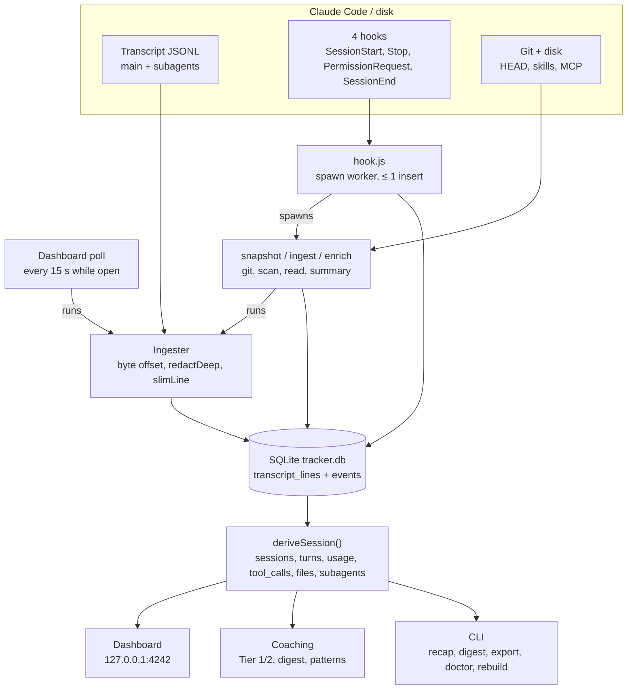
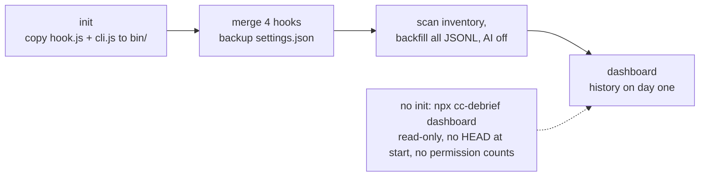

# cc-debrief architecture

How cc-debrief is put together: which processes run, where data comes from, how it is stored, and which modules
and functions the rest of the code depends on. Feature behaviour lives in [docs/features](features/); this file
covers the parts they share. When this file and the code disagree, the code is right and this file needs a fix.

## 1. Overview

cc-debrief is a local tracker for Claude Code sessions. Everything runs on the user's machine; nothing is sent
anywhere except the optional `claude -p` calls the user turns on (summaries, reviews, drafts, recap polish).

| Part | What it is | When it runs |
| --- | --- | --- |
| Hook (`hook.js`) | Tiny entry point Claude Code runs for four hook events | On `SessionStart`, `Stop`, `PermissionRequest`, `SessionEnd` |
| Workers | `cli.js snapshot`, `ingest`, `enrich` started detached by the hook | After the hook spawns them; they outlive it |
| CLI (`cli.js`) | `cc-debrief <command>` | When the user runs it |
| Dashboard server | Hono app on `127.0.0.1:<port>` serving `/api/*` and the built UI | While `cc-debrief dashboard` runs |
| UI | React app built to `dist/ui` | In the browser, against the local API |
| Database | SQLite file `~/.cc-debrief/tracker.db` via `node:sqlite` | Opened by the hook (one insert), workers, CLI and server |

Data directory (`~/.cc-debrief/`, or `CC_DEBRIEF_HOME`):

```
~/.cc-debrief/
├── tracker.db (+ -wal, -shm)   # all captured and derived data
├── config.json                 # sparse user settings over built-in defaults
├── bin/                        # stable copies of hook.js and cli.js, plus a version file
├── locks/                      # per-session lock files
├── drafts/                     # skill and CLAUDE.md rule drafts
├── raw/                        # raw hook stdin, only with CC_DEBRIEF_RAW_DUMP=1
├── hook-errors.log (+ .1)      # the hook's and workers' only error channel
└── coach-errors.log (+ .1)     # coaching, review and pattern errors
```

The only files written outside the data directory are Claude Code's `settings.json` (by `init` and `uninit`) and
installed skills or CLAUDE.md rules (by an explicit Install click in the dashboard).



Hooks never parse transcripts or run git: they start a detached worker and record at most one row. Everything
shown is derived from cc-debrief's own SQLite copy.

## 2. Capture model

**Transcript JSONL is the source of truth. Hooks decide when to read it, and cover the two things it does not
record** (git HEAD at session start, and approved permission prompts).

- Every transcript under `<claudeDir>/projects/*/` and its `<session-id>/subagents/*.jsonl` is ingested
  incrementally into `transcript_lines`, tracking a byte offset per file. The stored copy survives Claude Code's
  own transcript cleanup (`cleanupPeriodDays`).
- Tool calls, failures, denials, durations, prompts, responses, models, usage, skills, instruction files,
  compactions, subagents, surface and file edits all come from the JSONL. No hook fires per tool call or prompt.

### The four hooks

| Hook | Mode | Job |
| --- | --- | --- |
| `SessionStart` | sync | Spawn `snapshot <id> --cwd <cwd>`: git HEAD at the true start, repo inventory scan, catch-up ingest of changed transcripts. One `events` row |
| `Stop` | `async: true` | Spawn `ingest <id> [--expect <hash>]`: read new lines after each turn. No `events` row, SQLite never opened |
| `PermissionRequest` | sync | One `events` row (approved prompts are not in the JSONL; only denials are). Registered only while `capture.permissionHook` is true (the default) |
| `SessionEnd` | sync, `timeout: 3600` as a safety net | Spawn `enrich <id>` first, then one `events` row, then exit at once |

`SessionStart` carries `source` (`startup`, `resume`, `clear`, `compact`, `fork`), stored as
`sessions.start_reason`. `/clear` ends the session and starts a new id and file; `--fork-session` starts a new id
whose file copies the whole history; `resume` and `compact` keep the same id and file, so ingest appends.
`SessionEnd` carries `reason` (`prompt_input_exit`, `clear`, `other`, …). A `SessionStart` can arrive for a session
that never writes a transcript (the VS Code panel opens one before any prompt), so `snapshot` does not require
the file.

### When transcripts are read

After every turn (`Stop`), at session start (catch-up of any changed transcript), at session end (`enrich`),
every `dashboard.pollSeconds` (default 15) while the dashboard runs, on `dashboard` start, and on
`cc-debrief ingest`. Each read stats the files, skips unchanged ones and reads only bytes past the stored offset,
up to the last complete line.

- **Transcript lag.** The CLI can write a turn's final text a few hundred milliseconds after `Stop` fires. The
  `Stop` worker waits 500 ms before its first read and re-reads once more when the reply it was told to expect
  is not stored yet. No read is treated as complete; the next trigger picks up the rest.
- **Turns without `Stop`.** A turn interrupted with Esc, ended by denying a permission prompt, or ending in an API
  error fires no `Stop`. The next `Stop`, `SessionEnd`, `SessionStart` catch-up or dashboard poll ingests it.
- **`SessionEnd` is best-effort.** All `SessionEnd` hooks share a 1.5 s budget (raised up to 60 s when a hook sets
  `timeout` above 600). A hook that overruns is cancelled, and the cancel kills its detached children too. A long
  `timeout` lets a slow hook finish but delays the user's exit by its full run time. So the hook spawns `enrich`,
  inserts one row and exits well inside 1.5 s. If it is lost anyway, the `Stop` reads already hold the data; only
  the automatic summary waits.
- **In-progress sessions.** A session with no `SessionEnd` event whose last line is under 30 minutes old shows as
  in progress. Summaries and reviews wait for `SessionEnd`, or 24 h without new lines.

### Without hooks (read-only mode)

The tracker works without `init`: `ingest` and `dashboard` (with its poll) discover sessions by listing
transcripts and finding files with no `transcripts` row or a changed size or mtime. Two gaps remain: HEAD at
session start falls back to `headAt()` (reflog, then `git log --before`), and permission prompts are not counted.
`sessions.capture` is `hooks` when a `SessionStart` event exists for the session, else `backfill`.

Existing history is backfilled on `init` and on every `dashboard` start, with AI off.

### JSONL fields relied on

Fixtures for each surface and OS are in `test/fixtures/transcripts/`.

| Need | JSONL source |
| --- | --- |
| Surface | `entrypoint` on each line: `cli`, `claude-vscode`, `claude-desktop` |
| Turns | `type:"user"` lines with string content or text blocks, `promptId`; `isMeta` lines skipped |
| Responses, model, usage | `type:"assistant"` → `message.model`, `message.usage`, text blocks; deduped by `message.id` + `requestId` (last line wins) across all sessions; `message.model = "<synthetic>"` marks a Claude Code error reply and is never a model |
| Session totals | last `type:"cost-state"` line → `totalCostUSD` and `modelUsage.<model>.{inputTokens, outputTokens, thinkingTokens, cacheReadInputTokens, cacheCreationInputTokens, costUSD}`: equals `/cost`, includes subagents and background calls. In every CLI transcript, only some desktop ones |
| Tool calls | `tool_use` blocks (id, name, input) → matching `tool_result` (`is_error`); line `timestamp`s give duration. A failed `Bash` / `PowerShell` call has `is_error: true`, content starting `Exit code N`, and a string `toolUseResult`; `stderr` alone is not a failure |
| Denials | `toolDenialKind` at the top level of the line carrying the `tool_result` (`user-rejected`, `permission-rule`, `automode-blocked`, `automode-unavailable`, `interrupted`) |
| File edits | `toolUseResult.structuredPatch` / `filePath` on Edit / Write / MultiEdit results |
| Skills loaded | `attachment.type:"skill_listing"` → `names[]` (first has `isInitial: true`, later ones are deltas); `attachment.type:"dynamic_skill"` → `skillNames[]` for subdirectory skills. Plugin skills are `plugin:skill` |
| Skills invoked | `Skill` tool_use `input.skill`, and `<command-name>/skill</command-name>` slash commands. Not `invoked_skills` (it appears only after compaction and lists every skill used so far) |
| MCP attribution | `mcp__<server>__<tool>`; `mcp__plugin_<plugin>_<server>__<tool>` for plugin servers, `mcp__claude_ai_<Name>__<tool>` for claude.ai connectors |
| Titles | `custom-title` and `agent-name` lines (desktop), `ai-title` lines (CLI and VS Code) |
| Instruction files | `attachment.type:"instructions"` → `files[].path`, `files[].type` |
| Compaction | `type:"system", subtype:"compact_boundary"` → `compactMetadata.trigger`, `preTokens`, `postTokens` |
| Subagents | `<session-id>/subagents/agent-<id>.jsonl` + `.meta.json` (`agentType`, `description`, `toolUseId`) |
| Branch, cwd, version, permission mode | `gitBranch`, `cwd`, `version`, `permissionMode` per line |

Other line and attachment types are stored but not derived; `doctor` reports types it has never seen
(`KNOWN_LINE_TYPES`, `KNOWN_ATTACHMENT_TYPES` in `src/commands/doctor.ts`).

### One session

```mermaid
sequenceDiagram
  participant CC as Claude Code
  participant J as Transcript JSONL
  participant H as hook.js
  participant W as snapshot / ingest / enrich
  participant DB as SQLite
  CC->>H: SessionStart (session_id, source, cwd, transcript_path)
  H-)W: spawn snapshot (detached)
  H->>DB: events row
  W->>DB: head_start, branch, repo inventory
  W->>J: ingestPendingLocked() (catch-up of changed transcripts)
  loop every turn
    CC->>J: append prompt, tool calls, response (no hook per tool call)
    CC-)H: Stop (async: Claude does not wait)
    H-)W: spawn ingest <session_id> (skips if lock held)
    W->>J: read from stored offset (may miss last lines: transcript lags)
    W->>DB: transcript_lines + derived tables
  end
  opt permission prompt shown
    CC->>H: PermissionRequest (tool_name, tool_input)
    H->>DB: events row
  end
  CC->>H: SessionEnd (1.5 s budget, raised by timeout)
  H-)W: spawn enrich (detached, before opening SQLite)
  H->>DB: events row
  W->>J: final read from stored offset
  W->>DB: head_end, numstat, Tier 1, patterns, summary via claude -p (self_usage)
  Note over CC,DB: SessionEnd killed or missed: Stop reads already hold the data; next SessionStart, dashboard poll or dashboard start catches up
```

### First run



## 3. Hook runtime rules and global constraints

### Hook runtime

`src/hook.ts` is the only code Claude Code runs. It:

1. Sets `process.exitCode = 0`, drops every process warning (nothing may reach stderr), and reads stdin with a
   2 s timeout.
2. Calls `runHook(stdin, process.env)` inside `try/catch`. Errors go to `hook-errors.log` (one tab-separated line
   per error, rotated to `.1` above 1 MiB). It never writes stdout, never runs git, never reads a transcript and
   never touches the network.
3. Routes with `routeHook()` before loading anything heavy. The worker spawn happens before zod, the config
   schema or `node:sqlite` is loaded or the DB opened. The hook bundle contains no zod (it reads capture settings
   through `src/capture-config.ts`), which keeps it around 22 KB.
4. Spawns `node <dir of hook.js>/cli.js <args> --from-hook` with `{ detached: true, stdio: "ignore",
   windowsHide: true }` and `.unref()`. A detached child outlives the hook only when the hook exits on its own; a
   cancelled hook takes its children with it, so no event does anything slow.
5. Inserts at most one redacted `events` row (see the hook table in section 2), after the spawn.
6. Ignores a payload without a valid `session_id` (`/^[A-Za-z0-9-]{1,100}$/`, since ids reach argv and lock
   file names) or with an unknown event. With `CC_DEBRIEF_INTERNAL=1` it inserts nothing and spawns nothing.
7. Passes the `Stop` payload's `last_assistant_message` to the worker only as `--expect <hash>` (first 16 hex
   chars of SHA-256 over the first 200 characters, whitespace collapsed), never as text: command lines are
   visible to other processes and the reply may hold a secret.

### Workers and locks

- `snapshot`, `ingest <id>` and `enrich` take a per-session lock file `<dataDir>/locks/<session_id>.lock`
  holding `{ pid, startedAt }`. A lock whose pid is gone or which is older than 10 minutes is taken over.
- `ingest <id>` from `Stop` tries once (`waitMs: 0`) and exits if the lock is held; the next trigger reads the
  rest. `snapshot` and `enrich` wait up to 5 s, then exit without changes. The dashboard poll and catch-up
  ingests take the same locks and skip busy sessions.
- A Tier 2 review holds a separate lock, `review-<session_id>`, so a click is never blocked by `enrich` and two
  reviews of one session never overlap.
- Worker count stays bounded: at most one `ingest` per session at a time, and a turn produces at most one `Stop`.
- With `--from-hook` a command prints nothing, logs errors to `hook-errors.log` and exits 0.

### Performance budgets

| What | Budget |
| --- | --- |
| Hook's own work after Node starts | p95 ≤ 50 ms |
| Hook wall time including Node start (measured) | Windows 11 p50 80 ms / p95 109 ms; Linux p50 43 ms / p95 56 ms |
| `PermissionRequest` hook | `doctor` times one hook run and suggests turning it off above 150 ms |
| Derive per turn on a 20,000-line session | ≤ 300 ms (append path measures about 60 ms) |
| Database size | target ≤ 80 MB per 100 sessions including derived tables; perf suite fails above 0.8 MB per fixture session |
| `GET /api/recap` on 10,000 sessions | p95 ≤ 200 ms for a week, ≤ 50 ms for today |

`Stop` runs async, so only `SessionStart`, `PermissionRequest` and `SessionEnd` are ever waited on.

### Global constraints

- Node `>=22.13`, TypeScript strict, ESM. No native modules: storage is `node:sqlite` behind
  `src/db/adapter.ts`. Avoid `?1`-style numbered SQL parameters; Node 22.13 mis-binds them.
- `openDb()` sets `busy_timeout = 2000`, WAL, `foreign_keys = ON`, and `page_size = 8192` on a new file. The DB
  file is created `0600`; directories under the data dir `0700` (POSIX).
- `tsup` builds two self-contained bundles, `dist/cli.js` and `dist/hook.js` (`noExternal: [/.*/]`, so the
  published package has no runtime dependencies). `npm run build` = tsup, then `vite build --config
  ui/vite.config.ts` into `dist/ui`.
- Stable install location: `init` copies `hook.js` and `cli.js` into `<dataDir>/bin/` and the hook command points
  there (`node "<binDir>/hook.js" # cc-debrief`), so an `npx` install survives npx cache cleanup.
  `bin/version` records the copied version; `init` after an upgrade re-copies, and `doctor` warns when the copy is
  older than the running package. The bin copy has no UI: `dashboard` must run from the installed package.
- Hook entries carry the marker `# cc-debrief`. `init` also removes tracker entries under events that are not
  subscribed any more; `doctor` warns about them.
- The dashboard server binds `127.0.0.1` only, rejects a `Host` other than `127.0.0.1:<port>` or
  `localhost:<port>` (421), and rejects state-changing requests with a foreign `Origin` or a non-JSON
  `Content-Type` (403).
- Every table has `agent TEXT NOT NULL DEFAULT 'claude-code'`.
- Nothing is written inside a user's repo except by an explicit Install click.
- Windows: git and `claude` are spawned with `windowsHide`; a `claude -p` timeout kills the whole process tree
  (`taskkill /T /F`); `claude` is found through `PATH` / `PATHEXT`; the prompt goes on stdin because `cmd.exe`
  cannot carry a line break in an argument; repo paths are compared case-insensitively where Windows requires it.

## 4. Repository layout

```
cc-debrief/
├── package.json            # bin: cc-debrief -> dist/cli.js; files: dist; engines node >=22.13
├── tsup.config.ts          # entries src/cli.ts, src/hook.ts; .sql files loaded as text
├── biome.json, vitest.config.ts, playwright.config.ts, tsconfig.json
├── src/
│   ├── cli.ts              # bin entry: process.exitCode = await runCli(argv)
│   ├── program.ts          # createProgram() registers every command; runCli() maps errors to exit codes
│   ├── hook.ts             # hook entry: read stdin, runHook(), always exit 0
│   ├── paths.ts            # every filesystem location, read from process.env at call time
│   ├── config.ts           # config.json: ConfigSchema (zod), load, get, set, update
│   ├── capture-config.ts   # zod-free capture settings reader for the hook bundle
│   ├── redact.ts           # redaction patterns, redactDeep(), field capping
│   ├── locks.ts            # per-session lock files
│   ├── enrich.ts           # snapshotSession(), enrichSession(), enrichPending(), catchUpSummaries()
│   ├── version.ts          # VERSION
│   ├── hook/               # run.ts (routeHook, runHook, spawnWorker), payload.ts, errors.ts (error logs)
│   ├── ingest/             # files.ts (list transcripts), line.ts (parse, slimLine, payload codec), ingest.ts
│   ├── derive/             # session.ts (deriveSession), tools.ts, language.ts, inventory-usage.ts,
│   │                       # tool-categories.ts, pricing.ts (active price table), reprice.ts
│   ├── collector/          # git.ts, inventory.ts, transcript.ts (pure line helpers), prices.ts,
│   │                       # summarize.ts, memory.ts (repo memory files), storage.ts (dir sizes)
│   ├── claude/             # settings.ts (settings.json hook entries), headless.ts (runClaude: claude -p)
│   ├── coach/              # Tier 1 (tier1.ts, signals/), digest (digest.ts, digest-rules/), Tier 2 (review.ts,
│   │                       # review-band.ts), context.ts, feedback.ts, labels.ts, command-key.ts, types.ts
│   ├── patterns/           # repeat-pattern detection, drafts and install (see section 6)
│   ├── recap/              # work recap: range.ts, build.ts, format.ts, polish.ts, types.ts
│   ├── digest/             # terminal.ts: the `digest` command's text and Markdown output
│   ├── db/
│   │   ├── adapter.ts      # Db / Stmt interfaces, openDb(); the only module importing node:sqlite
│   │   ├── migrate.ts      # migrate(db, { to? })
│   │   ├── migrations/     # 001_init.sql … 009_inventory_kinds.sql
│   │   └── queries/        # all SQL for views and features, one file per table group or view
│   ├── server/             # app.ts (createApp), routes/, types.ts (API types shared with the UI),
│   │                       # security.ts (host/origin checks), static.ts (UI files), jobs.ts, progress.ts, errors.ts
│   └── commands/           # one file per CLI command; common.ts (Out, UsageError, ExitCode, withDb)
├── ui/
│   ├── vite.config.ts      # aliases @api-types, @redact, @rule-labels into src/
│   └── src/
│       ├── main.tsx, app.tsx, api.ts, styles.css
│       ├── routes/         # Overview, Activity, Costs, Sessions, SessionDetail, SkillsTools, Repos, Recap,
│       │                   # TasksPlans, Settings
│       ├── components/     # charts, tables, bands, buttons, palette, replay, editors
│       └── lib/            # format, ranges, richText, tokens (palettes), useApi, useFilters, useLiveRefresh
├── scripts/                # check-fixtures, scrub-fixture, scrub-hook-payloads, pack-smoke, test-tz
└── test/
    ├── unit/, ui/, e2e/, perf/, fixtures-replay/, scripts/
    ├── fixtures/           # hooks/, transcripts/, headless/, recap/, digest/, synthetic/
    └── helpers/            # tmp-home, guard-home, fake-claude, seed*, run-cli, git-repo
```

The UI imports API types from `src/server/types.ts` through `@api-types`, applies capture's own redaction rules in
the Settings test box through `@redact`, and shares rule labels through `@rule-labels`.

Test notes: `test/helpers/guard-home.ts` puts a recording `claude` first on `PATH` that fails the test file if it
ever runs; `fakeClaude(dir).install()` puts a scripted fake before it. `npm run test:tz` runs the date-sensitive tests
(recap, activity and costs, digest) once per time zone (`UTC`, `Asia/Kolkata`, `America/Los_Angeles`). `scripts/pack-smoke.mjs`
installs the packed tarball into a temp prefix and runs `--version`, `init --no-backfill`, `doctor`, `uninit`.

## 5. Data model

Current schema version: **9** (`meta.schema_version`). Migrations live in `src/db/migrations/`, are imported as
text and listed in `src/db/migrate.ts`; each runs in its own transaction and sets `schema_version`. A migration
entry may set `foreignKeysOff` for a table rebuild; foreign keys are then checked before commit.

### Migrations

| # | File | Change |
| --- | --- | --- |
| 1 | `001_init.sql` | Capture schema: `meta`, `repos`, `sessions`, `events`, `transcripts`, `transcript_lines`, `turns`, `usage`, `tool_calls`, `file_changes`, `instructions_loaded`, `subagents`, `compactions` |
| 2 | `002_inventory.sql` | `inventory`, `inventory_usage`; lookup indexes on `turns(session_id, seq)`, `file_changes(session_id)`, `instructions_loaded(session_id)` |
| 3 | `003_self_usage.sql` | `ai_calls` (daily-cap ledger), `self_usage` (the tracker's own `claude -p` usage) |
| 4 | `004_findings.sql` | `findings`, `rule_feedback`; `sessions.tier1_version` |
| 5 | `005_remove_rules.sql` | Deletes findings and rule feedback of two retired Tier 1 rules |
| 6 | `006_finding_dates.sql` | Re-dates session findings to the session's last activity |
| 7 | `007_reviews.sql` | `reviews` (Tier 2, one row per session) |
| 8 | `008_patterns.sql` | `patterns` (repeat-pattern candidates, drafts, installs) |
| 9 | `009_inventory_kinds.sql` | Rebuilds `inventory` with a wider `kind` CHECK (adds `agent`, `command`, `output_style`, `rule`, `workflow`), keeping row ids |

### Capture tables

| Table | Key columns |
| --- | --- |
| `events` | id, session_id, event (`SessionStart` / `PermissionRequest` / `SessionEnd`), ts, payload (redacted JSON). Index `(session_id, ts)` |
| `transcripts` | id, path (unique), session_id, agent_id (null = main), size, mtime_ms, bytes_ingested, first_line_uuid, lines, parse_errors, internal, cwd (first line's), first/last_ingested_at, missing_since, purged_at |
| `transcript_lines` | id, session_id, agent_id, file_id → `transcripts.id`, line_no, uuid, parent_uuid, type, subtype, ts, payload BLOB. Unique `(file_id, line_no)`; index `(session_id, ts)` |

`transcript_lines.payload`, `tool_calls.input` and `tool_calls.response` are stored with `encodePayload()` (raw
deflate of the JSON). Nothing reads inside them with SQL; anything a query filters or groups on has its own column.

### Derived tables

Rebuilt by `deriveSession()` from `transcript_lines` and `events`; `rebuild` can recreate them at any time.

| Table | Key columns |
| --- | --- |
| `sessions` | session_id PK, started_at, ended_at (last line), cwd, repo_id, branch, surface, entrypoint, cc_version, capture (`hooks` / `backfill`), start_reason, permission_mode, models (JSON), head_start, head_start_source (`snapshot` / `reflog` / `log`), head_end, title, agent_name, reported_cost_usd, reported_usage (JSON from the last cost-state line), enriched_at, tier1_version; AI columns summary, session_type, type_source, outcome, tags, summary_error |
| `turns` | id, session_id, prompt_id, seq, user_text, assistant_text, started_at, ended_at. Indexes `(started_at)`, `(session_id, seq)` |
| `usage` | id, session_id, agent_id, turn_id, message_id, request_id, model, input/output/cache_creation/cache_read tokens, cost_usd, ts. Unique `(message_id, COALESCE(request_id, ''))` where message_id is not null |
| `tool_calls` | id, session_id, agent_id, turn_id, tool_use_id, tool_name, mcp_server, mcp_source, mcp_tool, skill_name, input, response, started_at, ended_at, ok, denied, exit_code. Indexes `(session_id, tool_name)`, `(session_id, started_at)` |
| `file_changes` | id, session_id, tool_call_id, repo_id, path, lines_added, lines_removed, language, approx (1 when counted from truncated text) |
| `instructions_loaded` | id, session_id, file_path, kind, ts |
| `subagents` | (session_id, agent_id) PK, agent_type, description, tool_use_id, started_at, ended_at |
| `compactions` | id, session_id, ts, trigger, pre_tokens, post_tokens |
| `repos` | repo_id PK (normalized remote `host/org/repo`, else the root path), root_path, remote_url (no credentials), name |

`sessions.discard_checked_at` exists in the schema but is unused.

### Inventory, coaching and AI tables

| Table | Key columns |
| --- | --- |
| `inventory` | id, scope (`user` / `repo` / `plugin`), repo_id, kind (`skill`, `plugin`, `mcp`, `hook`, `agent`, `command`, `output_style`, `rule`, `workflow`), name, path, description, first_seen, last_seen, meta (JSON; MCP env values and headers never stored). Unique `(agent, scope, COALESCE(repo_id, ''), kind, name)` |
| `inventory_usage` | (inventory_id, session_id) PK, loaded, invoked |
| `ai_calls` | id, feature (`summary` / `review` / `draft` / `recap`), session_id (the call's own), target_session_id, ts. One row per attempt, written before the spawn |
| `self_usage` | id, feature, session_id (unique), target_session_id, model, token columns, cost_usd (this call's usage × price table), raw_total_cost_usd, ts |
| `findings` | id, session_id (null for digest and pattern findings), rule, subject_key, repo_id, severity, message, evidence (JSON), cost_tokens, created_at, dismissed_until, feedback. Unique `(COALESCE(session_id, ''), rule, subject_key)` |
| `rule_feedback` | rule PK, helpful, not_helpful, demoted, updated_at |
| `reviews` | id, session_id (unique, cascade), schema_version, result (JSON), cost_usd, model, created_at, feedback |
| `patterns` | id, repo_id (null = cross-repo), label, label_norm, kind (`repo_skill`, `user_skill`, `claude_md_rule`, `claude_md_pointer`, `test_gap`), session_ids (JSON), tokens_total, fingerprint, meta (JSON), first_seen, last_seen, status (`candidate`, `drafted`, `installed`, `dismissed`), draft_path, inventory_id → `inventory(id)` on delete set null, installed_at, dismissed_at. Unique `(COALESCE(repo_id, ''), kind, label_norm)` |

### `meta` keys

| Key | Meaning |
| --- | --- |
| `schema_version` | Last applied migration |
| `init.backup_path`, `init.before_sha256`, `init.after_sha256`, `init.created` | What `init` changed in `settings.json`, so `uninit` can restore the original bytes |
| `derive:<session_id>` | Append-path state for `deriveSession()` |
| `rederive:<session_id>` | Session queued for a re-derive (usage ownership moved) |
| `skills:<session_id>` | The session's skill signals (listed, dynamic, slash commands) |
| `numstat:<session_id>` | `enrich`'s git numstat reconciliation, re-applied on every derive |
| `last_scan_user`, `last_scan_repo:<repo_id>` | Last inventory scan per scope; `last_seen` older than it means removed |
| `dismiss:<rule>:<subject>` | Dismissal of a session-less finding, copied onto recomputed rows |
| `nudge.<name>.dismissed_at` | Dismissed UI nudges (`overview`, `session`) |
| `price_table_version` | Effective price table the derived costs use |
| `last_retention_run`, `ingest_not_before` | Retention bookkeeping; `purge --all` sets the second |

## 6. Key interfaces

Condensed signatures of the modules other code depends on. Read the source for the full types.

### Paths, config, redaction, DB

```ts
// src/paths.ts: every function reads process.env at call time
dataDir()            // CC_DEBRIEF_HOME || ~/.cc-debrief
dbPath()             // CC_DEBRIEF_DB || <dataDir>/tracker.db
configPath(), draftsDir(), rawDir(), binDir(), locksDir(), hookErrorsLogPath(), coachErrorsLogPath()
claudeDir()          // CLAUDE_CONFIG_DIR || ~/.claude
claudeSettingsPath(), projectsDir()  // <claudeDir>/settings.json, <claudeDir>/projects
claudeJsonPath()     // <CLAUDE_CONFIG_DIR>/.claude.json when set, else ~/.claude.json
ensureDir(path)      // mkdir -p, mode 0700 on POSIX

// src/db/adapter.ts
interface Db { exec(sql); prepare(sql): Stmt; transaction<T>(fn: () => T): T; close() } // nested = savepoints
function openDb(path?: string): Db
// src/db/migrate.ts
function migrate(db: Db, opts?: { to?: number }): void

// src/config.ts
const ConfigSchema; type Config
loadConfig(): Config                        // defaults on any problem; configErrors() lists them
loadCaptureConfig(): CaptureConfig          // re-exported from capture-config.ts (no zod)
getConfigValue(key), setConfigValue(key, raw), updateConfig({ set?, unset? })
configErrors(), unknownConfigKeys(), explicitConfigKeys()
class ConfigError { fields: { key, message }[] } // CLI exit 2, API 422/400

// src/redact.ts
DEFAULT_REDACT, DEFAULT_HINT, expandPatterns(list)  // "@default" → DEFAULT_REDACT
redact(text, patterns), capField(text, maxBytes)    // "[REDACTED]", "…[truncated N bytes]"
redactDeep<T>(value: T, patterns, maxBytes): T      // every string leaf
```

### Hook, settings and locks

```ts
// src/hook/run.ts
routeHook(payload, env): { spawn: string[] | null; insert: boolean }
runHook(stdin, env, db?, deps?: { spawn?, now? }): Promise<void>   // never rejects
spawnWorker(cliArgs), expectHash(text), SESSION_ID
// src/hook/errors.ts
appendErrorLog(path, err, label?), logHookError(err, event?)

// src/claude/settings.ts: the only writer of Claude Code's settings.json (init / uninit)
HOOK_MARKER = "# cc-debrief"
SUBSCRIBED_EVENTS = ["SessionStart", "Stop", "PermissionRequest", "SessionEnd"]
HOOK_ENTRY_OPTIONS   // Stop: { async: true }, SessionEnd: { timeout: 3600 }
hookCommand(hookJsAbsPath)                          // node "<path>" # cc-debrief
installHooks(settingsPath, command, { permissionHook? }) // added, skipped, replaced, staleRemoved, backupPath, created, …
removeHooks(settingsPath, { created? })
replaceFile(path, bytes)   // atomic temp-file + rename; writes through a symlink
class SettingsError        // invalid JSON or shape: CLI exit 3, nothing written
```

Settings edits are made by text offsets on a `jsonc-parser` tree, so bytes outside the tracker's entries never
change and install-then-remove restores the original bytes. The file is validated as strict JSON before and after.

```ts
// src/locks.ts
withSessionLock<T>(id, { waitMs }, fn): Promise<T | "busy">
trySessionLockSync(id): (() => void) | null   // one synchronous try; no-op release when already held here
sessionLockHeld(id): boolean                  // used for "review-<id>" (review running)
```

### Ingest and derive

```ts
// src/ingest/files.ts
listTranscripts({ since? }): TranscriptFile[]   // { path, sessionId, agentId, size, mtimeMs }
readSubagentMeta(file)

// src/ingest/line.ts
parseLine(raw), lineColumns(line)
slimLine(line): Obj | null       // drops bulky fields before storage (see below); null = not stored
encodePayload(value), decodePayload(blob)

// src/ingest/ingest.ts
ingestFile(db, file, deps?), ingestFiles(db, files, deps?), ingestSession(db, sessionId, deps?)
ingestPending(db, { since?, ... }): IngestResult                  // synchronous, no locks (recap, digest, rebuild)
ingestPendingLocked(db, { since?, onProgress?, signal? }): Promise<IngestResult>  // workers, poll, dashboard
pendingGroups(db, opts?): { files; bySession }
deriveSessions(db, ids, deps?)    // one derive per session, then drains the rederive queue
commitFiles(db, commits), markMissingFiles(db, listedPaths, now?)

// src/derive/session.ts
deriveSession(db, sessionId, { full? }): void
forgetDerive(db, sessionId)       // called by anything that deletes a session's stored lines
surfaceFromEntrypoint(entrypoint) // cli | vscode | desktop | unknown
withFreshPayloads(payloads, fn)   // hands just-stored payloads to the derive that follows

// src/derive/inventory-usage.ts
skillSignals(lines), recordSkillSignals(db, id, lines, replace), deriveInventoryUsage(db, id)
applyScan(db, items, scopeKey, now?), scanUserInto(db), scanRepoInto(db, root, repoId)
// src/derive/tools.ts, language.ts, tool-categories.ts
parseToolName(name, input), exitCodeFrom(content), languageFor(path), toolCategory(name, mcpServer)
// src/derive/pricing.ts, reprice.ts
activePricing(overrides?): { table, version }      // memoized per distinct overrides
stalePriceSessions(db, version?), repriceStale(db, { signal?, onProgress? })
```

**Ingest pipeline.** Per file: read from the stored offset to the last complete line; per line `redactDeep()`
(redact and cap at `capture.maxFieldBytes`), then `slimLine()`, then `encodePayload()`; insert into
`transcript_lines`; then `deriveSession()` for that session with the fresh payloads, one session at a time so
backfill memory is bounded. A file that shrank or changed identity (first-line uuid) is re-read from 0. A file's
done marker (size, mtime, `last_ingested_at`) is written only after its session is derived, so a poll never
refreshes the UI before the new turn is derived and a killed worker leaves the file pending.

**`slimLine()`** drops `file-history-snapshot` lines, instruction and `invoked_skills` file contents,
`skill_listing.content`, `toolUseResult.originalFile`, `toolUseResult` stdout / stderr / content already present in
the `tool_result`, thinking `signature`s, and per-line `sessionId` / `cwd`; caps tool_result text at 8 KB and hook
output at 1 KB; replaces image data with `[image N bytes]`; keeps only scalar fields and name lists of a few
bulky attachment types. It keeps `custom-title`, `agent-name`, `ai-title` and `cost-state` lines whole.

**Derive.** `deriveSession()` is idempotent and synchronous and never runs git. With stored state in
`meta derive:<id>` it takes an append path that reads only the last turn and newer lines; it falls back to a full
rebuild on the first derive, with `full` (enrich, rebuild), when a sentinel prompt is involved, when new lines
touch a file covered by numstat reconciliation, when a subagent file appears without its metadata, and after
`forgetDerive()`. A property test ingests every fixture in uneven chunks and compares all derived rows with a full
rebuild. `file_changes.repo_id` is resolved against existing `repos` rows by longest root-path prefix; the async
workers upsert repos via `repoInfo()` and re-derive.

`tool_calls.response` stores `{ toolUseResult, bytes, isError, excerpt, origBytes? }`: the first 4,096 bytes of
the result, its length, and the size before any truncation marker. `toolUseResult` keeps `structuredPatch`,
`filePath` and short scalar fields only.

### Collectors

```ts
// src/collector/transcript.ts (pure, over StoredLine[])
usageFromLines(lines): UsageRow[]    // one row per message.id + requestId; skips "<synthetic>"
costStateFrom(lines): CostState | null
sessionTitles(lines): { title, agentName }  // last custom-title, else last ai-title; last agent-name

// src/collector/git.ts: execa, 3 s timeout, LC_ALL=C, GIT_OPTIONAL_LOCKS=0; failures → null / []
repoInfo(cwd), headSha(root), headAt(root, iso), numstat(root, fromRef), addedLinesSince(root, sinceIso, paths)
repoIdFor(info), normalizeRemote(url)

// src/collector/prices.ts
PRICE_TABLE_VERSION, PRICE_TABLE, PLAN_PRICES
modelFamily(id, table?), estimateCost(usage, table?)   // null = unknown model
effectivePriceTable(overrides), effectivePriceVersion(overrides)

// src/collector/inventory.ts: pure scans, no DB writes
scanUser({ repos? }), scanRepo(root, repoId), upsertInventory(db, items, scopeKey, now?)
frontMatter(text)      // YAML front matter only; other engines refused
workspaceDir(kind), estimateContextTokens(description)

// src/collector/summarize.ts
summarizeSessionResult(db, id, cfg, opts?): Promise<SummaryOutcome>   // { status, costUsd, reason }
pendingSummaryIds(db, opts?), buildStoredTurnsPrompt(db, id, maxChars = 60_000)
estimateSummaryCost(db, cfg), estimateFeatureCost(db, cfg, feature, now?), heuristicType(calls)

// src/collector/memory.ts, storage.ts
listMemoryFiles(root), readMemoryFile(root, name)   // read on request, never stored; 64 KB cap
dirSize(root, budgetMs?), projectsSize({ fresh? }), formatBytes(r)
```

`estimateCost()` = (input × in + output × out + 5-minute cache writes × cacheWrite + 1-hour cache writes ×
cacheWrite1h + cacheRead × read) / 1e6, in USD per million tokens.

### Enrich

```ts
// src/enrich.ts
snapshotSession(db, sessionId, cwd)   // SessionStart worker: repo, branch, head_start, repo scan, catch-up ingest
enrichSession(db, sessionId, { ai, explicit?, catchUp?, config? }, cache?): Promise<SummaryOutcome | null>
enrichPending(db, { ai, limit?, signal? })     // enriched_at IS NULL, oldest first, one GitCache per run
catchUpSummaries(db, cfg, { limit?, exclude?, now? })  // up to 5 pending hook sessions from 7 days
```

`enrichSession()` holds the session lock (5 s wait) for: final ingest, git end state (`head_end`, `head_start`
from reflog / log when no snapshot recorded it, numstat reconciliation), `enriched_at`, Tier 1, pattern detection
for the session, and the summary when `ai` is on. After releasing the lock it runs the auto-review (only when
reviews and auto-review are on and the session is auto-eligible) and, from the `SessionEnd` hook, the catch-up.

### Headless Claude calls

```ts
// src/claude/headless.ts
runClaude<T>({ prompt, schema, feature, model?, timeoutMs?, db, targetSessionId?, cap?, now? }): Promise<ClaudeResult<T>>
type ClaudeResult<T> = { result: T; sessionId; costUsd: number | null; rawTotalCostUsd; usage; model? }
class ClaudeError { reason: "not_found" | "capped" | "exit" | "timeout" | "parse" | "schema" | "budget" }
TOOL_LIMITS = ["--tools", "", "--strict-mcp-config", "--max-budget-usd", "0.50"]
claudeArgs({ schema, model? }), findOnPath(name, env?), callTranscriptsDir()
```

Every call: env `CC_DEBRIEF_INTERNAL=1` and `CC_DEBRIEF_FEATURE=<feature>`; the prompt starts with the sentinel
line `[cc-debrief:<feature>]` and goes on stdin; args `-p --output-format json --json-schema <schema>` plus
`TOOL_LIMITS` and `--model` when set; cwd = the data dir. `claude` missing → `not_found` before any ledger row.
Timeout (default 120 s) kills the process tree. A parseable result records `self_usage` even when it then fails.
The call's transcript is deleted from `callTranscriptsDir()` afterwards; purge and retention sweep leftovers. Caps,
cost and retry rules are in section 8.

### Coaching

```ts
// src/coach/tier1.ts: SIGNALS long_session_no_compaction, mcp_bypassed, retry_loop, context_churn, permission_friction
TIER1_VERSION = 2
runTier1(db, sessionId, opts?), runTier1Pending(db, { since, limit?, onProgress? }), logCoachError(err, context)
// src/coach/digest.ts: DIGEST_RULES unused_skill, unused_mcp, cache_hit_dip, model_mix, tool_failure_hotspot,
// spend_spike, budget_over
DIGEST_COST_FLOOR_TOKENS = 50_000
runDigestRules(db, now?, rules?), buildDigest(db, { range, repo?, now?, cfg?, limit? }): ImprovementsResponse
// src/coach/context.ts, types.ts, labels.ts, command-key.ts
loadSessionContext(db, id), costTokensOf(u)   // input + cache creation + output
type Finding = { rule, severity, message, evidence, costTokens, target, at? }
RULE_LABELS, ruleLabel(rule), commandKey(command)
// src/coach/feedback.ts
recordFeedback(db, findingId, value), dismissFinding(db, id, days?), dismissSessionFindings(db, id, days?)
enableRule(db, rule), isDemoted(db, rule), recordReviewFeedback(db, sessionId, value)
// src/coach/review.ts (Tier 2)
TIER2_RULES = ["goal_drift", "review_friction"], REVIEW_SCHEMA, ReviewResultSchema, REVIEW_TIMEOUT_MS = 180_000
reviewSession(db, id, cfg, { trigger: "auto" | "click", now?, timeoutMs? }): Promise<ReviewOutcome>
reviewEligibility(db, id, cfg, now?), eligibleReviewIds(db, cfg, now?, days = 7)
buildReviewPrompt(db, id), estimateReviewCost(db, id, cfg), estimateReviewAll(db, ids, cfg), reviewFindings(result, ctx)
// src/coach/review-band.ts
sessionReviewBand(db, id, cfg, now?): ReviewBand
// src/db/queries/findings.ts
upsertFindings(db, sessionId | null, rules, findings, now?)   // keyed (session, rule, subject_key); keeps feedback
findingGroup(db, id), listFindings(...), reviewBand(db, id, cfg, now?)
```

A finding's `created_at` is when it happened (`at`, else the session's last activity), not when the rule ran, so
imported history and re-checks stay out of this week's digest. On `dashboard` start, Tier 1 re-checks sessions
from the last 30 days whose `tier1_version` is older, then the digest rules run, then pattern detection.

### Patterns, drafts and install

`src/patterns/` detects repeated work with pure JS over the DB (no git, network or `claude`), except drafts and
kept-line checks.

| File | Exports |
| --- | --- |
| `fingerprint.ts` | `toolSkeleton()`, `trigrams()`, `trigramJaccard()`, `fingerprintText()` |
| `similarity.ts`, `labels.ts` | `terms()`, `tfidfCosine()`, `normalizeLabel()`, `sameLabel()` |
| `graph.ts` | `buildGraph()`, `components()`; `FINGERPRINT_JACCARD = 0.6`, `PROMPT_COSINE = 0.5` |
| `candidate.ts` | `DetectSession`, `Candidate`, `qualifies()` (≥ 3 sessions and ≥ 50,000 non-cached tokens) |
| `classify.ts` | `classifyComponent()`, `correctionCandidates()`, `pointerCandidate()`, `testGapPath()` |
| `detect.ts` | `detectPatterns(db, repoId)`, `syncCandidates()`, `loadDetectSessions()`; 30-day window, ≤ 500 sessions |
| `crossrepo.ts` | `crossRepoPatterns(db)` (user skills seen in ≥ 2 repos) |
| `run.ts` | `detectForSession(db, id)` (enrich), `runPatternDetection(db, { signal?, afterwards? })` (dashboard start) |
| `kept-lines.ts` | `keptAddedLines(db, id)`: the session's added lines that appear in git history since it started |
| `context.ts` | `buildDraftContext()`, `estimateContextChars()`; context ≤ 60,000 chars |
| `draft.ts` | `draftPattern()` (one `claude -p` call, no retry, no daily cap), `draftDeterministic()` (rules and pointers, no AI), `readDraft()`, `saveDraft()`, `validateSkillMd()` |
| `install.ts` | `resolveInstallTarget()`, `installDraft()`, `assertContained()`: the only writes outside the data dir |
| `adoption.ts` | `adoptionStats()`, `checkInstalledPatterns()` (`skill_not_triggering` findings) |
| `views.ts` | `patternRows()`, `repoSuggestions()`, `proposedSkills()`, `digestAction()` |

Drafts are written to `drafts/<repo slug | user>/<slug>/` as `SKILL.md` or `RULE.md` plus `draft.json` (dirs
`0700`, files `0600`). Draft front matter is read only through `frontMatter()`. Install refuses an existing
target, a missing repo, an invalid draft, or any path segment that is a symlink or junction or resolves outside
the root; new files are created with flag `wx`; CLAUDE.md is appended to, never rewritten; nothing is committed.

### Recap and terminal digest

```ts
// src/recap/
resolveRange(input, now?): RecapRange            // RecapRangeError: CLI exit 2, API 400 invalid_range
buildRecap(db, cfg, { range, groupBy: "repo" | "day", files, now? }): Recap
formatText(r), formatMarkdown(r), formatRepo(r, repo, format), rangeLabel(r)
polishRecap(db, recap, cfg, { timeoutMs? }), estimatePolishCost(db, recap, cfg)  // the only AI call in recap
// src/db/queries/recap.ts
recapRows(db, fromIso, toIso), recapFiles(...), recapReads(...)
// src/digest/terminal.ts
buildTerminalDigest(db, cfg, { days, repo?, now }), formatDigestText(d), formatDigestMarkdown(d)
```

### Query modules

All dashboard SQL lives in `src/db/queries/`. The ones other modules lean on:

| Module | Main exports |
| --- | --- |
| `usage.ts` | `sessionTotals(db, id)`: the one source of a session's headline total (`reported` or `counted`) |
| `totals.ts` | `totalsFor(db, idsSql, params)`: totals for many sessions, by model, with unattributed usage |
| `range.ts` | `rangeStart()`, `rangeBounds()`, `dayBuckets()` (≤ 366 days), `localDate()` |
| `status.ts` | `getStatus()`, `IN_PROGRESS_MINUTES = 30`, `inProgressSql(alias)` |
| `selfUsage.ts` | `recordSelfUsage()`, `isInternalSession()`, `aiCallsToday()`, `selfUsageSummary()`, `selfUsageLine()`, `cleanupInternalSessions()` |
| `retention.ts` | `purgeOlderThan()`, `purgeAll()`, `runRetention()` (once per 24 h), `retentionPreview()` |
| `repos.ts` | `upsertRepo()`, `listRepos()`, `getRepoDetail()` |
| `sessions.ts`, `overview.ts`, `inventory.ts`, `tools.ts` | List and detail views |
| `costs.ts`, `budget.ts`, `activity.ts`, `replay.ts`, `tasks.ts`, `adoption.ts` | Costs, budget, activity, replay, tasks and plans, feature adoption and versions |
| `reviews.ts`, `patterns.ts`, `ruleFeedback.ts`, `improvements.ts`, `meta.ts` | Storage for reviews, patterns, rule votes, digest footer and nudges, meta keys |

### Dashboard server

```ts
// src/server/app.ts
createApp(db, { port, uiDir }): Hono
// order: hostCheck(port) → originCheck(port) → /api routes → unknown /api path 404 → serveUi(uiDir)
class HttpError(status, code, message)   // errors are { error: { code, message } }
// src/server/jobs.ts: single-flight jobs inside the dashboard process
startSummaryJob(db, ids, cfg), startReviewJob(db, ids, cfg)   // number | "busy"
startRepriceJob(db, signal?)                                   // also started by PUT /api/config on pricing changes
getSummaryJob(), getReviewJob()                                // shown in GET /api/status
getRepriceJob()                                                // shown in GET /api/config (pricing.repricing)
// src/server/progress.ts
setBackfillProgress(), setTier1Progress()                      // shown in GET /api/status
// src/commands/dashboard.ts
runDashboard({ port?, open, uiDir?, ... }), startPoll(db, seconds), pollOnce(db), coachInBackground(db, signal)
```

`serveUi()` returns a file for a path whose every decoded segment is safe and inside `uiDir`, `index.html` for the
client routes (`/`, `/activity`, `/costs`, `/sessions`, `/skills`, `/repos`, `/recap`, `/tasks`, `/settings`), and
404 otherwise.

`dashboard` start: check `<uiDir>/index.html` → migrate → clean up internal sessions → retention → inventory scan
(user, plus repos with sessions in the last 30 days) → pending ingest in the foreground when ≤ 50 sessions are
pending, else in the background with progress → listen on `127.0.0.1` → print the URL and open the browser
(unless `--no-open`) → in the background: inventory usage for old sessions, `enrichPending` with AI off in batches
of 200, the re-price job, then coaching → start the poll. SIGINT / SIGTERM stops everything and closes the DB.

### API routes

All routes are under `/api`. `range` is `today | 7d | 30d | 90d | all`. State-changing requests are rejected
cross-origin. Response types are in `src/server/types.ts`; behaviour in [12](features/12-dashboard.md) and the
feature doc named per row.

| Route | File | Purpose |
| --- | --- | --- |
| `GET /status` | `overview.ts` | Last ingest and hook times, backfill / Tier 1 / job progress, in-progress and pending counts; the UI polls it for live refresh |
| `GET /overview?range&repo` | `overview.ts` | Overview tiles, charts, budget |
| `GET /improvements?range&repo` | `overview.ts` | Coaching digest items and footer ([09](features/09-weekly-coaching-digest.md)) |
| `GET /sessions`, `GET /sessions/:id` | `sessions.ts` | Session list (cursor paging) and detail |
| `GET /sessions/:id/replay` | `sessions.ts` | Turn-by-turn replay |
| `POST /sessions/:id/summarize` | `sessions.ts` | One summary ([06](features/06-ai-session-summary.md)) |
| `GET /summaries/estimate`, `POST /summaries/run` | `sessions.ts` | Bulk summaries job |
| `POST /sessions/:id/review`, `POST /sessions/:id/review/feedback` | `sessions.ts` | Tier 2 review and its feedback ([08](features/08-session-review-tier2.md)) |
| `POST /reviews/run` | `sessions.ts` | Review-all job |
| `GET /findings`, `POST /findings/:id/feedback`, `POST /findings/:id/dismiss`, `POST /findings/rules/:rule/enable` | `findings.ts` | Findings, votes, dismissals, re-enabling a demoted rule ([07](features/07-session-review-tier1.md)) |
| `GET /inventory?kind&range&repo&unused`, `GET /tools` | `inventory.ts` | Inventory with usage; tool stats ([05](features/05-inventory-scan.md), [03](features/03-tool-mcp-skill-usage.md)) |
| `GET /adoption`, `GET /versions` | `inventory.ts` | Feature adoption and Claude Code versions |
| `GET /repos`, `GET /repos/:id` | `repos.ts` | Repo list and detail with suggestions ([04](features/04-repo-file-attribution.md)) |
| `GET /repos/:id/memory`, `GET /repos/:id/memory/:name` | `repos.ts` | Claude Code memory files of a repo, read on request |
| `GET /patterns?repo&status` | `patterns.ts` | Pattern rows ([10](features/10-repeat-pattern-detection.md)) |
| `POST /patterns/:id/dismiss`, `/draft`, `/draft-rule`, `/install`; `GET`, `PUT /patterns/:id/draft` | `patterns.ts` | Drafting, editing and installing ([11](features/11-skill-claudemd-suggestions.md)) |
| `GET /recap`, `POST /recap/polish` | `recap.ts` | Work recap; one polish at a time per process ([17](features/17-work-recap.md)) |
| `GET /costs?range&repo` | `costs.ts` | Cost charts, model table, run rate, budget ([18](features/18-activity-costs-budget.md)) |
| `GET /activity?range` | `activity.ts` | Activity heatmap, streaks, hours |
| `GET /tasks-plans?range&repo&status&q` | `tasks.ts` | Tasks and plans from transcripts |
| `GET /config`, `PUT /config`, `GET /config/retention-preview` | `config.ts` | Settings ([16](features/16-settings.md)) |
| `GET /self-usage` | `config.ts` | The tracker's own AI spend ([15](features/15-self-usage-tracking.md)) |
| `POST /nudges/:name/dismiss`, `POST /nudges/reset` | `config.ts` | UI nudges |

### CLI commands

Registered in `src/program.ts`, one file per command in `src/commands/`. Each exports
`register<Name>Command(program)` and a `run…()` function tests call in-process; human output goes through an `Out`
writer. Exit codes: 0 ok, 1 runtime failure, 2 usage or validation (`UsageError`, `ConfigError`), 3
`settings.json` refused (`SettingsError`). Full flags and output: [13](features/13-cli.md).

| Command | Job |
| --- | --- |
| `init [--no-backfill]` | Copy bundles to `bin/`, merge hook entries (with backup), scan inventory, backfill |
| `uninit` | Remove hook entries; restore the original bytes when nothing else changed |
| `doctor` | Health checks (hooks, bin copy, DB, config, transcripts, hook timing, storage); exit 1 on any FAIL |
| `ingest [id] [--since] [--all]` | Read new transcript lines; the `Stop` worker with hidden `--from-hook --expect` |
| `snapshot <id> [--cwd]` | Hidden; the `SessionStart` worker |
| `enrich [id] [--ai/--no-ai] [--since] [--limit]` | Git end state and summaries; the `SessionEnd` worker with `--from-hook` |
| `scan [path]` | Inventory scan of user scope and the repo holding `path` |
| `dashboard [--port] [--no-open]` | Local dashboard server |
| `recap` | Work recap for a day or range (`--today`, `--week`, `--by-day`, `--markdown`, `--json`, `--polish`, …) |
| `digest [--days 7\|30] [--format text\|md\|json] [--repo]` | Coaching digest in the terminal, from findings as last computed |
| `export` | JSON or CSV export (`--days`, `--repo`, `--include-raw`, `--force`); re-runs redaction |
| `purge [--all] [--yes] [--dry-run]` | Retention purge now, or delete everything |
| `rebuild [--reingest]` | Re-derive every session from stored lines and events |
| `config get [key]`, `config set <key> <value>` | Read or change `config.json` |

## 7. Environment variables and config files

| Variable | Purpose |
| --- | --- |
| `CC_DEBRIEF_HOME` | Data dir (default `~/.cc-debrief`). Tests always set it to a temp dir |
| `CC_DEBRIEF_DB` | DB file (default `<dataDir>/tracker.db`) |
| `CLAUDE_CONFIG_DIR` | Claude Code config dir (default `~/.claude`); also moves `.claude.json` inside it |
| `CC_DEBRIEF_INTERNAL` | `1` on the tracker's own `claude -p` calls; hooks inherit it and record nothing |
| `CC_DEBRIEF_FEATURE` | `summary` / `review` / `draft` / `recap` on those calls |
| `CC_DEBRIEF_SQLITE` | `node` (default). `better-sqlite3` is recognised but throws "not bundled in this build"; any other value throws |
| `CC_DEBRIEF_RAW_DUMP` | `1` makes the hook also write raw stdin to `<dataDir>/raw/` (debug aid) |

### Files read

| File | Read for |
| --- | --- |
| `<dataDir>/config.json` | User settings, sparse over defaults |
| `<claudeDir>/settings.json` | Hook entries (written only by `init` / `uninit`); hook inventory |
| `<claudeDir>/projects/**.jsonl` | Transcripts |
| `~/.claude.json` (see `CLAUDE_CONFIG_DIR`) | MCP servers, user and per project |
| `<claudeDir>/plugins/installed_plugins.json` | Installed plugins and their skills |
| `<claudeDir>/{skills,agents,commands,output-styles,rules,workflows}` | User inventory |
| `<repo>/.claude/skills` (and nested), `<repo>/.mcp.json`, `<repo>/.claude/settings.json` | Repo inventory |
| `<repo>/CLAUDE.md`, `<claudeDir>/projects/<slug>/memory/` | Repo detail, memory files (read on request) |

### `config.json` keys

Validated by `ConfigSchema` in `src/config.ts`; an invalid value falls back to its default and is reported by
`doctor` and the Settings page. Details in [16](features/16-settings.md).

| Key | Default | Range |
| --- | --- | --- |
| `ai.summaries.enabled` | `true` | |
| `ai.maxPerDay` | `50` | 0–1000 (summary attempts per local day) |
| `ai.review.enabled`, `ai.review.auto` | `false`, `false` | |
| `ai.review.autoThreshold.turns`, `.tokens` | `20`, `200000` | 1–10,000; 1,000–100,000,000 |
| `ai.review.maxPerDay` | `10` | 0–1000 |
| `ai.drafts.enabled` | `false` | |
| `ai.model` | unset | model id or alias |
| `capture.redact` | `["@default"]` | ≤ 200 regex patterns |
| `capture.maxFieldBytes` | `32768` | 1,024–1,048,576 |
| `capture.permissionHook` | `true` | |
| `retention.days` | `90` | 0–3650 (0 = keep everything) |
| `recap.hiddenRepos` | `[]` | ≤ 200 names |
| `budget.monthlyUsd` | `null` | 0.01–1,000,000 or null |
| `pricing.overrides` | `{}` | model id or family → `{ input, output, cacheWrite?, cacheWrite1h?, cacheRead? }`, 0–10,000 per million tokens |
| `dashboard.port` | `4242` | 1024–65535 |
| `dashboard.pollSeconds` | `15` | 0 (off) or 5–300 |

`pricing.overrides` is a map setting: `config set pricing.overrides.<model> '{...}'` works, and a bad entry falls
back as a whole. Changing it changes the effective price version; the dashboard's re-price job then re-derives
every session priced with an older table. Reported cost-state totals keep Claude Code's own cost.

## 8. Cross-feature rules

- **Session totals.** A session's headline tokens and cost come from `sessions.reported_usage` /
  `reported_cost_usd` (the last `cost-state` line) when present: it matches `/cost` and includes subagents and
  background calls. Otherwise they are the sum of `usage` rows and the UI marks them "at least". A session that
  shares message ids with an earlier one uses the `usage` sum, because its cost-state includes the parent's usage.
  Per-turn, per-model and per-day breakdowns always come from `usage` rows.
- **Usage ownership.** `usage` rows are deduped by `message.id` + `requestId` across all sessions: a message copied
  into a fork or rewind belongs to the session that started first, ordered by `(started_at, session_id)`. When a
  key moves, the losing session is queued under `meta rederive:<id>` and re-derived after the current derives.
- **Totals.** Tokens = input + output + cache creation + cache read. Cache share = cache read ÷ (input + cache
  creation + cache read). Coaching costs, the auto-review threshold and pattern sizes count non-cached tokens
  only: input + cache creation + output. "Week" = rolling 7 days. Daily caps reset at local midnight.
- **Synthetic replies.** Assistant lines with `model: "<synthetic>"` are Claude Code's own error replies; they end
  a turn but never count as a model or usage.
- **Redaction.** `redactDeep()` runs over every string leaf before the hook's `events` insert and, in ingest,
  before `slimLine()`: slimming cuts tool results to 8 KB and hook output to 1 KB, and cutting first could leave
  part of a secret that no pattern matches any more. `export` re-runs redaction with the current pattern list.
- **Internal sessions.** The hook drops events with `CC_DEBRIEF_INTERNAL=1`. Ingest skips the tracker's own
  transcripts by session id (`ai_calls` / `self_usage`) and, as a fallback, by the `[cc-debrief:` sentinel in any
  user prompt; such files get `transcripts.internal = 1` and their lines are never stored. No call uses
  `--resume` or `--fork-session`.
- **AI calls.** Every `claude -p` call sends the stored-turns prompt (≤ 60,000 chars) with all tools off
  (`TOOL_LIMITS`), because the prompt holds untrusted session text and no call needs a tool. Summaries retry once.
  Reviews, drafts and recap polish never retry, since they are click-driven and a retry would double the cost.
- **Daily caps.** Summaries (`ai.maxPerDay`) and reviews (`ai.review.maxPerDay`) pass their cap to `runClaude()`,
  which reserves the `ai_calls` row with one `INSERT … SELECT` that counts today's rows under SQLite's write lock.
  Every attempt is checked, so retries and parallel workers cannot exceed the cap; over it, nothing is spawned.
  Drafts and recap polish have no daily cap (click only).
- **Actual cost of internal calls.** `ClaudeResult.costUsd` = the call's own `usage` × price table, never
  `total_cost_usd`. A budget error
  reports all-zero `usage`, so its cost comes from `modelUsage`. `self_usage.cost_usd`, `reviews.cost_usd` and
  every "actual cost" label use `costUsd`; `raw_total_cost_usd` is kept for comparison.
- **Backfill.** `init` and `dashboard` ingest all transcripts with AI off. Backfilled sessions are never
  auto-summarized; `enrich --ai --since <date>` summarizes them on request within the daily cap. Hook-only signals
  (`permission_friction`) skip backfilled sessions, and auto-review skips them.
- **Pending summaries.** A session is pending when it has ended (a `SessionEnd` event, or no line for 24 h), has ≥ 2
  turns, no AI summary and no `summary_error`, regardless of `enriched_at`.
- **Review eligibility.** A session is eligible when reviews are on, it has ended, it is not reviewed, and it
  crosses a threshold: more turns than `autoThreshold.turns`, more non-cached tokens than `autoThreshold.tokens`,
  or a high finding of a non-demoted Tier 1 rule. Auto-review additionally needs `ai.review.auto` and a
  hook-captured session. Tier 2 findings never feed back into eligibility.
- **No re-import after deletion.** Retention keeps a purged session's `transcripts` rows (`purged_at`, offset at
  the end of the file); ingest skips a never-read transcript whose last line is older than the retention cutoff
  (and does not even list one last written before it); `purge --all` sets `meta.ingest_not_before`. Automatic retention and
  internal-session cleanup run at `dashboard` start and at the end of every `enrich` command.
- **`rebuild`.** Re-derives everything from `transcript_lines` and `events`, so it works after Claude Code deletes
  the transcript files. It keeps AI-derived session columns and git state, and never touches `findings`,
  `reviews`, `patterns`, `self_usage`, `rule_feedback`, `inventory` or `meta`. `--reingest` first clears the stored
  lines of files still on disk and re-reads them from 0; sessions whose files are gone keep their stored lines.
- **Work recap privacy.** Recap output (text, Markdown, JSON, API, polish prompt) never contains `turns.user_text`
  or a path with directories. Bullets come from `sessions.title`, the first sentence of `sessions.summary`,
  `sessions.agent_name`, then file base names. `recap.hiddenRepos` is applied before grouping. A recap day is a
  local calendar day; a session appears on each day it has turns.
- **Repo ids in API responses.** A repo without a remote has its root path as id. Responses carry repo ids so the
  UI can link `/repos/:id`; that is the one place a full local path appears in an API response.
- **One model setting.** `ai.model` applies to every internal call; unset means Claude Code's default.

## 9. Feature index

| # | Feature |
| --- | --- |
| 01 | [Session capture](features/01-session-capture.md) |
| 02 | [Token and cost tracking](features/02-token-cost-tracking.md) |
| 03 | [Tool, MCP and skill usage](features/03-tool-mcp-skill-usage.md) |
| 04 | [Repo and file attribution](features/04-repo-file-attribution.md) |
| 05 | [Inventory scan](features/05-inventory-scan.md) |
| 06 | [AI session summary](features/06-ai-session-summary.md) |
| 07 | [Session review, Tier 1](features/07-session-review-tier1.md) |
| 08 | [Session review, Tier 2](features/08-session-review-tier2.md) |
| 09 | [Weekly coaching digest](features/09-weekly-coaching-digest.md) |
| 10 | [Repeat-pattern detection](features/10-repeat-pattern-detection.md) |
| 11 | [Skill and CLAUDE.md suggestions](features/11-skill-claudemd-suggestions.md) |
| 12 | [Dashboard](features/12-dashboard.md) |
| 13 | [CLI](features/13-cli.md) |
| 14 | [Local-only and privacy](features/14-local-only-privacy.md) |
| 15 | [Self-usage tracking](features/15-self-usage-tracking.md) |
| 16 | [Settings](features/16-settings.md) |
| 17 | [Work recap](features/17-work-recap.md) |
| 18 | [Activity, costs and budget](features/18-activity-costs-budget.md) |
